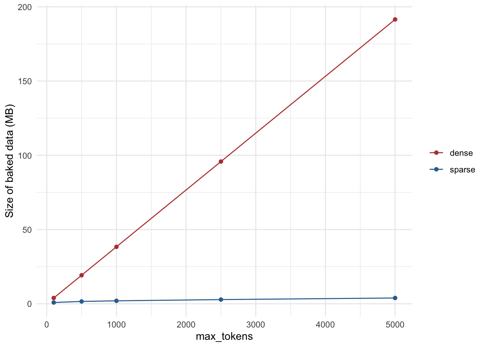

Back in 2020 I wrote a [series of posts](/blog.html#category=textrecipes%20series) about the text preprocessing steps in [textrecipes](https://textrecipes.tidymodels.org/).
Three of them covered the workhorses of bag-of-words modeling: [term frequency](/post/textrecipes-series-tf/), [TF-IDF](/post/textrecipes-series-tfidf/), and [feature hashing](/post/textrecipes-series-featurehashing/).
They all have the same problem hiding in plain sight.
Take 10,000 documents and keep the 5,000 most common words, and you get a table with 50 million cells, of which maybe 99% are zero.
Back then, every one of those zeros took up 8 bytes of memory.

That is no longer the case.
textrecipes now works with [sparsevctrs](https://sparsevctrs.tidymodels.org/) to store these columns sparsely, and tidymodels can pass them along to models that know what to do with them.
Instead of redoing the three posts one by one, this post walks through them as three short stories, each with one lesson about sparsity:

1. **Term frequency**: what a sparse column is and how much memory it saves.
2. **TF-IDF**: how a single innocent-looking step can silently undo all of it.
3. **Feature hashing**: what you can do once the number of columns stops being your constraint.

## Packages 📦

This post was written with textrecipes 1.2.0 and sparsevctrs 0.4.0.
Sparse support in recipes needs both, so update if you are running older versions.


::: {.cell}

```{.r .cell-code}
library(tidymodels)
library(textrecipes)
library(lobstr)

theme_set(theme_minimal())
```
:::


## The data 🍷

All three stories use the same data: the [wine reviews](https://github.com/rfordatascience/tidytuesday/tree/master/data/2019/2019-05-28) from #tidytuesday that I used in the original TF-IDF post.
We will predict the number of points a wine got from the text of its review.


::: {.cell}

```{.r .cell-code}
wine_ratings <- readr::read_csv(
  "https://raw.githubusercontent.com/rfordatascience/tidytuesday/master/data/2019/2019-05-28/winemag-data-130k-v2.csv"
) |>
  select(points, description) |>
  drop_na()

wine_ratings
```

::: {.cell-output .cell-output-stdout}

```
# A tibble: 129,971 × 2
   points description                                                           
    <dbl> <chr>                                                                 
 1     87 Aromas include tropical fruit, broom, brimstone and dried herb. The p…
 2     87 This is ripe and fruity, a wine that is smooth while still structured…
 3     87 Tart and snappy, the flavors of lime flesh and rind dominate. Some gr…
 4     87 Pineapple rind, lemon pith and orange blossom start off the aromas. T…
 5     87 Much like the regular bottling from 2012, this comes across as rather…
 6     87 Blackberry and raspberry aromas show a typical Navarran whiff of gree…
 7     87 Here's a bright, informal red that opens with aromas of candied berry…
 8     87 This dry and restrained wine offers spice in profusion. Balanced with…
 9     87 Savory dried thyme notes accent sunnier flavors of preserved peach in…
10     87 This has great depth of flavor with its fresh apple and pear fruits a…
# ℹ 129,961 more rows
```


:::
:::


That is a lot of reviews, so for the first two stories we will work with a random sample of 10,000 of them to keep things quick.
Here is one of them, so we know what kind of text we are dealing with.


::: {.cell}

```{.r .cell-code}
set.seed(1234)
wine_small <- slice_sample(wine_ratings, n = 10000)

wine_small$description[1]
```

::: {.cell-output .cell-output-stdout}

```
[1] "Blackberries, asphalt, char and black pepper show on the nose of this bottling from a winery in Morgan Hill. It's a little thin on the palate, especially for what can be a thick and dense grape, but the flavors are solid, with dark plum, coffee and pepper."
```


:::
:::


## Story 1: term frequency, or what a sparse column is

We start with the same kind of recipe as in the original term frequency post.
We tokenize the descriptions, remove stop words, keep the most common tokens, and count how often each token appears with `step_tf()`.
I'm using `weight_scheme = "binary"`, which just records whether a word appears in the review at all.

The new part is the `sparse` argument.
It takes `"auto"`, `"yes"`, or `"no"`.
Let's build the same recipe twice, once of each kind, keeping the 1,000 most common tokens.


::: {.cell}

```{.r .cell-code}
tf_recipe <- function(sparse, max_tokens = 1000, data = wine_small) {
  recipe(points ~ description, data = data) |>
    step_tokenize(description) |>
    step_stopwords(description) |>
    step_tokenfilter(description, max_tokens = max_tokens) |>
    step_tf(description, weight_scheme = "binary", sparse = sparse)
}

tf_dense <- tf_recipe("no") |> prep() |> bake(new_data = NULL)
tf_sparse <- tf_recipe("yes") |> prep() |> bake(new_data = NULL)

dim(tf_dense)
```

::: {.cell-output .cell-output-stdout}

```
[1] 10000  1001
```


:::

```{.r .cell-code}
dim(tf_sparse)
```

::: {.cell-output .cell-output-stdout}

```
[1] 10000  1001
```


:::
:::


Both have the same shape, 10,000 rows and 1,001 columns (1,000 tokens and the outcome).
Taking a look at one of the token columns from each, they look identical when printed.


::: {.cell}

```{.r .cell-code}
tf_dense[[2]][1:10]
```

::: {.cell-output .cell-output-stdout}

```
 [1] 0 0 0 0 0 0 0 0 0 0
```


:::

```{.r .cell-code}
tf_sparse[[2]][1:10]
```

::: {.cell-output .cell-output-stdout}

```
 [1] 0 0 0 0 0 0 0 0 0 0
```


:::
:::


But they are not the same underneath.
The sparse column is a special vector type from sparsevctrs that only stores the positions and values of the non-zero entries.


::: {.cell}

```{.r .cell-code}
sparsevctrs::is_sparse_vector(tf_dense[[2]])
```

::: {.cell-output .cell-output-stdout}

```
[1] FALSE
```


:::

```{.r .cell-code}
sparsevctrs::is_sparse_vector(tf_sparse[[2]])
```

::: {.cell-output .cell-output-stdout}

```
[1] TRUE
```


:::
:::


The difference shows up in memory.


::: {.cell}

```{.r .cell-code}
obj_size(tf_dense)
```

::: {.cell-output .cell-output-stdout}

```
40.22 MB
```


:::

```{.r .cell-code}
obj_size(tf_sparse)
```

::: {.cell-output .cell-output-stdout}

```
2.09 MB
```


:::
:::


That is a big difference for the same information, and it gets bigger the more tokens we keep.
Dense memory grows linearly with the number of columns, but sparse memory only grows with the number of non-zero entries, and rare words add very few of those.
Let's measure it for a range of `max_tokens`.


::: {.cell}

```{.r .cell-code}
tf_sizes <- expand_grid(
  max_tokens = c(100, 500, 1000, 2500, 5000),
  sparse = c("no", "yes")
) |>
  mutate(
    size = map2_dbl(max_tokens, sparse, \(n, s) {
      tf_recipe(s, max_tokens = n) |>
        prep() |>
        bake(new_data = NULL) |>
        obj_size() |>
        as.numeric()
    }),
    sparse = if_else(sparse == "yes", "sparse", "dense")
  )

tf_sizes |>
  ggplot(aes(max_tokens, size / 1024^2, color = sparse)) +
  geom_line() +
  geom_point() +
  scale_color_manual(values = c(dense = "#B8423F", sparse = "#2F6F9F")) +
  labs(x = "max_tokens", y = "Size of baked data (MB)", color = NULL)
```

::: {.cell-output-display}
{width=672}
:::
:::


At 5,000 tokens the dense version is hundreds of megabytes while the sparse version is still only a handful.

### What about `"auto"`?

You will rarely need to write `sparse = "yes"` yourself.
The default is `"auto"`, and it decides based on what is going to happen to the data.
When you `prep()` and `bake()` a recipe on its own, as we did above, `"auto"` gives you regular dense columns, because it can't know what you plan to do with the result.
When the recipe is part of a workflow, tidymodels checks whether the model engine can handle sparse data, and only then does it go sparse.

That check is available to us too.
Here are a few engines, and whether they accept sparse predictors.


::: {.cell}

```{.r .cell-code}
c("linear_reg", "logistic_reg", "boost_tree", "rand_forest", "svm_linear", "svm_rbf") |>
  map(get_encoding) |>
  list_rbind() |>
  filter(mode != "quantile regression") |>
  distinct(model, engine, allow_sparse_x) |>
  arrange(model, desc(allow_sparse_x), engine)
```

::: {.cell-output .cell-output-stdout}

```
# A tibble: 27 × 3
   model      engine  allow_sparse_x
   <chr>      <chr>   <lgl>         
 1 boost_tree xgboost TRUE          
 2 boost_tree C5.0    FALSE         
 3 boost_tree spark   FALSE         
 4 linear_reg glmnet  TRUE          
 5 linear_reg brulee  FALSE         
 6 linear_reg glm     FALSE         
 7 linear_reg keras   FALSE         
 8 linear_reg keras3  FALSE         
 9 linear_reg lm      FALSE         
10 linear_reg spark   FALSE         
# ℹ 17 more rows
```


:::
:::


glmnet, xgboost, ranger, and LiblineaR can all use sparse data directly.
Look at `svm_rbf()` though: neither of its engines can.
That is the model I used in the original term frequency post, and with it every sparse column would be turned back into a dense one before fitting.
Not every model is a good match for sparse text features, so it is worth checking before you tune something for hours.

For the rest of the post we will use two engines that can: glmnet and xgboost.

## Story 2: TF-IDF, or how to accidentally make everything dense again

The TF-IDF post used `step_tfidf()` to weight each token by how rare it is across all reviews, and then finished with `step_normalize(all_predictors())` because lasso regression wants all predictors on the same scale.
That recipe was fine in 2020.
With sparse columns, there is a trap in that last step.

Here is the recipe up to and including `step_tfidf()`, with `sparse = "yes"`, followed by three different ways of putting predictors on a common scale.


::: {.cell}

```{.r .cell-code}
tfidf_base <- recipe(points ~ description, data = wine_small) |>
  step_tokenize(description) |>
  step_stopwords(description) |>
  step_tokenfilter(description, max_tokens = 1000) |>
  step_tfidf(description, sparse = "yes")

bake_size <- function(rec) {
  baked <- rec |> prep() |> bake(new_data = NULL)
  tibble(
    size_mb = as.numeric(obj_size(baked)) / 1024^2,
    sparse = sparsevctrs::is_sparse_vector(baked[[2]])
  )
}

list(
  "tfidf only" = tfidf_base,
  "+ step_normalize()" = tfidf_base |> step_normalize(all_predictors()),
  "+ step_scale()" = tfidf_base |> step_scale(all_predictors()),
  "+ step_range()" = tfidf_base |> step_range(all_predictors())
) |>
  map(bake_size) |>
  list_rbind(names_to = "recipe")
```

::: {.cell-output .cell-output-stdout}

```
# A tibble: 4 × 3
  recipe             size_mb sparse
  <chr>                <dbl> <lgl> 
1 tfidf only            2.70 TRUE  
2 + step_normalize()   76.5  FALSE 
3 + step_scale()        2.81 TRUE  
4 + step_range()       76.5  FALSE 
```


:::
:::


`step_normalize()` turned a 3 MB table into an 80 MB one.
Normalizing means subtracting the mean, and subtracting a non-zero mean from a column of zeros gives you a column of non-zeros.
Every zero we worked so hard to avoid storing is back.
`step_range()` has the same problem for the same reason, since it shifts the minimum to zero.
`step_scale()` only divides, zero stays zero, and the data stays sparse.

The general rule is that a recipe is only as sparse as its least sparse step.
Steps that multiply or divide by a constant preserve sparsity, and steps that add or subtract one destroy it.
The recipes documentation has a list of which steps do what.

So what do we do about the lasso?
We drop the normalization entirely and let the model take care of it.
glmnet standardizes the predictors internally by default, which was the reason for `step_normalize()` in the first place.

Let's fit the model with both approaches (the original normalized and dense recipe, and the new sparse one) and compare.
The comparison is on a train/test split of our 10,000 reviews.


::: {.cell}

```{.r .cell-code}
set.seed(1234)
wine_split <- initial_split(wine_small, strata = points)
wine_train <- training(wine_split)
wine_test <- testing(wine_split)

tfidf_recipe <- function(sparse, data = wine_train) {
  recipe(points ~ description, data = data) |>
    step_tokenize(description) |>
    step_stopwords(description) |>
    step_tokenfilter(description, max_tokens = 1000) |>
    step_tfidf(description, sparse = sparse)
}

lasso_spec <- linear_reg(penalty = 0.005, mixture = 1) |>
  set_engine("glmnet")

wf_dense <- workflow(tfidf_recipe("no") |> step_normalize(all_predictors()), lasso_spec)
wf_sparse <- workflow(tfidf_recipe("yes"), lasso_spec)

fit_time <- function(wf) {
  bench::mark(fit(wf, wine_train), iterations = 3, check = FALSE)
}

timings <- bind_rows(
  dense = fit_time(wf_dense),
  sparse = fit_time(wf_sparse),
  .id = "version"
) |>
  select(version, median, mem_alloc)
```

::: {.cell-output .cell-output-stderr}

```
Warning: Some expressions had a GC in every iteration; so filtering is
disabled.
Warning: Some expressions had a GC in every iteration; so filtering is
disabled.
```


:::

```{.r .cell-code}
timings
```

::: {.cell-output .cell-output-stdout}

```
# A tibble: 2 × 3
  version   median mem_alloc
  <chr>   <bch:tm> <bch:byt>
1 dense      916ms     568MB
2 sparse     289ms     124MB
```


:::
:::


The sparse version is a lot faster and allocates far less memory.
The question is whether we lost anything on the way.


::: {.cell}

```{.r .cell-code}
fit_dense <- fit(wf_dense, wine_train)
fit_sparse <- fit(wf_sparse, wine_train)

bind_rows(
  dense = augment(fit_dense, wine_test) |> rmse(points, .pred),
  sparse = augment(fit_sparse, wine_test) |> rmse(points, .pred),
  .id = "version"
)
```

::: {.cell-output .cell-output-stdout}

```
# A tibble: 2 × 4
  version .metric .estimator .estimate
  <chr>   <chr>   <chr>          <dbl>
1 dense   rmse    standard        2.12
2 sparse  rmse    standard        2.12
```


:::
:::


The error is about the same.
The two aren't identical, since the dense version also centers the predictors and the sparse one doesn't, but the model quality is a wash, and the sparse path got there faster.

### The same trick works for xgboost

Tree-based models don't need any scaling at all, so xgboost is an even easier fit.
Here the only change is `sparse = "yes"` versus `"no"`, with the exact same model.


::: {.cell}

```{.r .cell-code}
xgb_spec <- boost_tree(trees = 200) |>
  set_engine("xgboost") |>
  set_mode("regression")

xgb_timings <- bind_rows(
  dense = fit_time(workflow(tfidf_recipe("no"), xgb_spec)),
  sparse = fit_time(workflow(tfidf_recipe("yes"), xgb_spec)),
  .id = "version"
) |>
  select(version, median, mem_alloc)
```

::: {.cell-output .cell-output-stderr}

```
Warning: Some expressions had a GC in every iteration; so filtering is
disabled.
Warning: Some expressions had a GC in every iteration; so filtering is
disabled.
```


:::

```{.r .cell-code}
xgb_timings
```

::: {.cell-output .cell-output-stdout}

```
# A tibble: 2 × 3
  version   median mem_alloc
  <chr>   <bch:tm> <bch:byt>
1 dense      1.53s     327MB
2 sparse     1.31s     119MB
```


:::
:::


### Leaving it to `"auto"`

Since we are putting these recipes in workflows, we didn't actually need to say `sparse = "yes"` at all.
The leave-it-alone version does the right thing for glmnet and xgboost, and falls back to dense for engines like kernlab that can't handle it.


::: {.cell}

```{.r .cell-code}
wf_auto <- workflow(tfidf_recipe("auto"), lasso_spec)

bench::mark(fit(wf_auto, wine_train), iterations = 3, check = FALSE) |>
  select(median, mem_alloc)
```

::: {.cell-output .cell-output-stderr}

```
Warning: Some expressions had a GC in every iteration; so filtering is
disabled.
```


:::

::: {.cell-output .cell-output-stdout}

```
# A tibble: 1 × 2
    median mem_alloc
  <bch:tm> <bch:byt>
1    291ms     124MB
```


:::
:::


## Story 3: feature hashing, or what you can do when columns are cheap

In the feature hashing post, the argument for `step_texthash()` was that it gives you a fixed number of columns no matter how big your vocabulary is.
You hash each token to one of `num_terms` buckets, and different tokens sometimes land in the same bucket.
The price is collisions, so you want `num_terms` to be large.

With dense columns, "large" was limited by memory.
The default of 1,024 columns was already heavy, and going much beyond that was painful.
Let's see how the sizes compare on our 10,000 reviews as we turn `num_terms` up.


::: {.cell}

```{.r .cell-code}
hash_recipe <- function(num_terms, sparse = "yes", data = wine_small) {
  recipe(points ~ description, data = data) |>
    step_tokenize(description) |>
    step_texthash(description, num_terms = num_terms, sparse = sparse)
}

hash_sizes <- tibble(num_terms = 2^c(10, 12, 14, 16, 18)) |>
  mutate(
    sparse_mb = map_dbl(num_terms, \(n) {
      hash_recipe(n) |> prep() |> bake(new_data = NULL) |> obj_size() |> as.numeric() / 1024^2
    }),
    # 8 bytes per double, for every row and every column
    dense_mb = nrow(wine_small) * num_terms * 8 / 1024^2
  )

hash_sizes
```

::: {.cell-output .cell-output-stdout}

```
# A tibble: 5 × 3
  num_terms sparse_mb dense_mb
      <dbl>     <dbl>    <dbl>
1      1024      3.11     78.1
2      4096      4.38    312. 
3     16384      9.12   1250  
4     65536     27.9    5000  
5    262144    103.    20000  
```


:::
:::


I didn't measure the dense numbers for the larger sizes.
I computed them, because actually building a 10,000 by 262,144 dense table is a good way to crash your R session: it would take around 20 GB.
The sparse versions stay in the same ballpark as the original, because the number of non-zero entries is set by the number of tokens in the text, and not by the number of buckets.

That changes what is practical.
Let's use the full 130,000 reviews, with 65,536 hashed columns, which would be about 68 GB dense, and fit a lasso on it.


::: {.cell}

```{.r .cell-code}
set.seed(1234)
wine_full_split <- initial_split(wine_ratings, strata = points)
wine_full_train <- training(wine_full_split)
wine_full_test <- testing(wine_full_split)

hash_wf <- workflow(
  hash_recipe(2^16, sparse = "auto", data = wine_full_train),
  linear_reg(penalty = 0.001, mixture = 1) |> set_engine("glmnet")
)

hash_time <- system.time(
  hash_fit <- fit(hash_wf, wine_full_train)
)

hash_time[["elapsed"]]
```

::: {.cell-output .cell-output-stdout}

```
[1] 277.314
```


:::
:::


And how does it do compared to a regular bag of words with a fixed vocabulary?
For the baseline we use the 1,000 most common tokens with `step_tf()`, on the same data and the same model.


::: {.cell}

```{.r .cell-code}
tf_wf <- workflow(
  tf_recipe("auto", max_tokens = 1000, data = wine_full_train),
  linear_reg(penalty = 0.001, mixture = 1) |> set_engine("glmnet")
)

tf_fit <- fit(tf_wf, wine_full_train)

bind_rows(
  `hash, 65,536 columns` = augment(hash_fit, wine_full_test) |> rmse(points, .pred),
  `tf, 1,000 columns` = augment(tf_fit, wine_full_test) |> rmse(points, .pred),
  .id = "recipe"
)
```

::: {.cell-output .cell-output-stdout}

```
# A tibble: 2 × 4
  recipe               .metric .estimator .estimate
  <chr>                <chr>   <chr>          <dbl>
1 hash, 65,536 columns rmse    standard        1.78
2 tf, 1,000 columns    rmse    standard        1.90
```


:::
:::


The hashed model sees far more of the vocabulary, including the rare words that the 1,000 token cutoff throws away, and it does better because of it.
It pays for that in interpretability: a coefficient belongs to a bucket instead of a word, and a bucket can hold several unrelated words, so you can't read the model the way you can read the one trained on `step_tf()`.

Two other arguments of `step_texthash()` are worth a mention here.
`signed = TRUE` (the default) uses a second hash function to assign each token a sign, so that colliding tokens tend to cancel instead of adding up.
And if you want to hash a categorical column rather than text, `step_dummy_hash()` does the same thing and has the same `sparse` argument.

## Wrapping up

There is a short checklist if you are going to do text modeling with textrecipes in a modern tidymodels setup:

- Leave `sparse = "auto"` alone and put your recipe in a workflow. It goes sparse when the engine supports it and stays dense when it doesn't.
- Check that your engine can handle sparse data with `get_encoding()`. glmnet, xgboost, ranger, and LiblineaR can. kernlab can't.
- Watch the steps that come after `step_tf()`, `step_tfidf()`, and `step_texthash()`. Anything that shifts values (`step_normalize()`, `step_range()`) makes the data dense, while steps that only scale (`step_scale()`) don't.
- If memory was what kept you from using more tokens or more hash buckets, it probably doesn't anymore.

If you want to see how these steps worked before sparse support, the original posts are still up: [term frequency](/post/textrecipes-series-tf/), [TF-IDF](/post/textrecipes-series-tfidf/), and [feature hashing](/post/textrecipes-series-featurehashing/).
