::: {.slidecraft-grid}

::: {.slidecraft-card}
[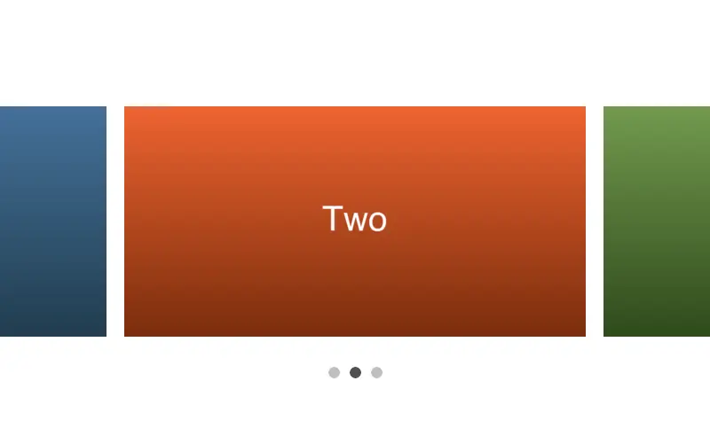{fig-alt="Carousel extension" loading="lazy"}](https://github.com/EmilHvitfeldt/quarto-easycarousel)

**[Carousel](https://github.com/EmilHvitfeldt/quarto-easycarousel)**
:::

::: {.slidecraft-card}
[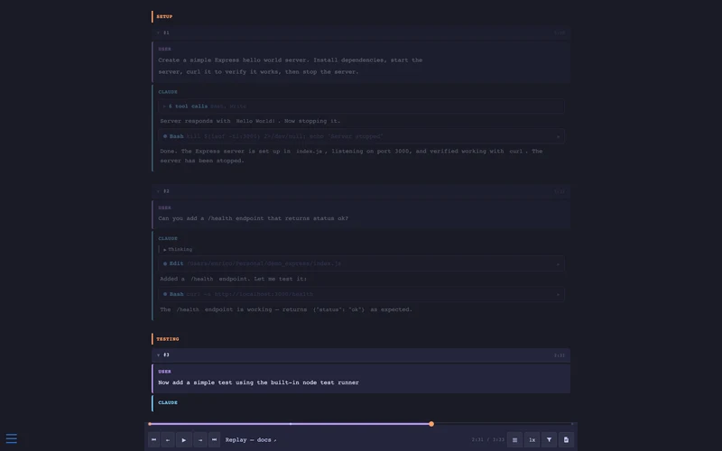{fig-alt="Claude Replay extension" loading="lazy"}](https://github.com/EmilHvitfeldt/quarto-claude-replay)

**[Claude Replay](https://github.com/EmilHvitfeldt/quarto-claude-replay)**
:::

::: {.slidecraft-card}
[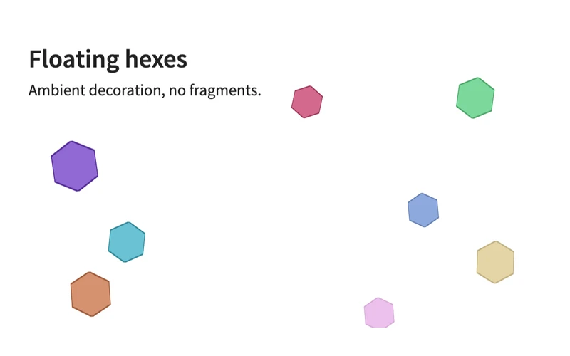{fig-alt="Anime extension" loading="lazy"}](https://github.com/EmilHvitfeldt/quarto-revealjs-anime)

**[Anime](https://github.com/EmilHvitfeldt/quarto-revealjs-anime)**
:::

::: {.slidecraft-card}
[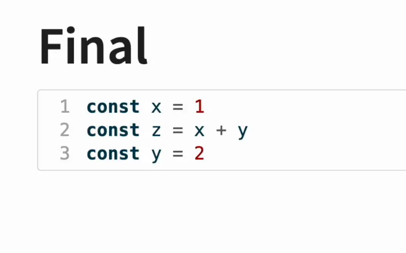{fig-alt="Magic Move extension" loading="lazy"}](https://github.com/EmilHvitfeldt/quarto-revealjs-magic-move)

**[Magic Move](https://github.com/EmilHvitfeldt/quarto-revealjs-magic-move)**
:::

::: {.slidecraft-card}
[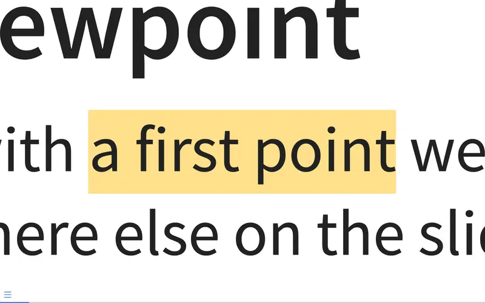{fig-alt="Zoom extension" loading="lazy"}](https://github.com/EmilHvitfeldt/quarto-revealjs-zoom)

**[Zoom](https://github.com/EmilHvitfeldt/quarto-revealjs-zoom)**
:::

::: {.slidecraft-card}
[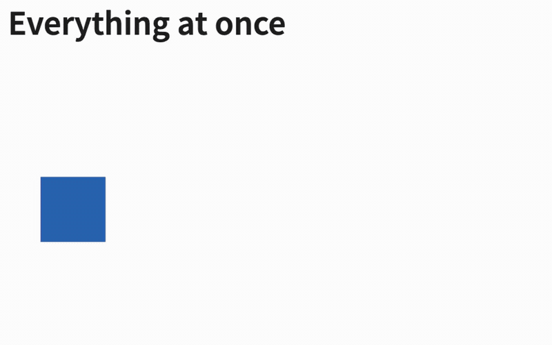{fig-alt="Auto-Animate Extra extension" loading="lazy"}](https://github.com/EmilHvitfeldt/quarto-revealjs-autoanimate-extra)

**[Auto-Animate Extra](https://github.com/EmilHvitfeldt/quarto-revealjs-autoanimate-extra)**
:::

::: {.slidecraft-card}
[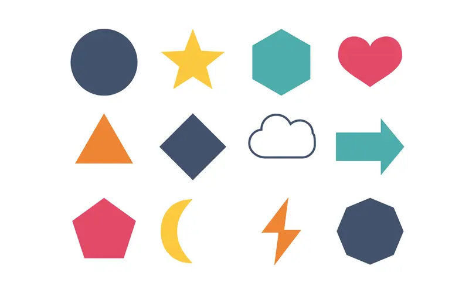{fig-alt="Shapes extension" loading="lazy"}](https://github.com/EmilHvitfeldt/quarto-shapes)

**[Shapes](https://github.com/EmilHvitfeldt/quarto-shapes)**
:::

::: {.slidecraft-card}
[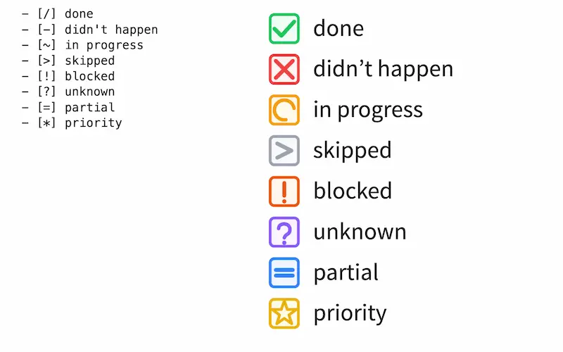{fig-alt="Checklist Fragments extension" loading="lazy"}](https://github.com/EmilHvitfeldt/quarto-revealjs-checklist-fragments)

**[Checklist Fragments](https://github.com/EmilHvitfeldt/quarto-revealjs-checklist-fragments)**
:::

::: {.slidecraft-card}
[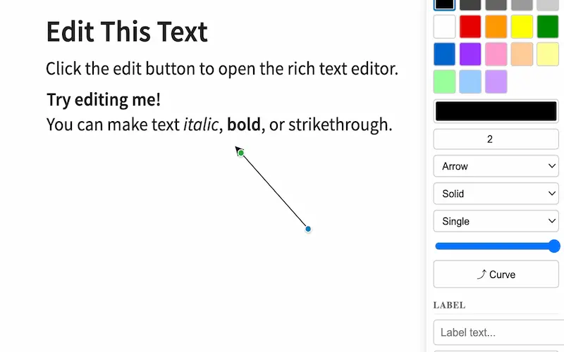{fig-alt="Editable extension" loading="lazy"}](https://github.com/EmilHvitfeldt/quarto-revealjs-editable)

**[Editable](https://github.com/EmilHvitfeldt/quarto-revealjs-editable)**
:::

::: {.slidecraft-card}
[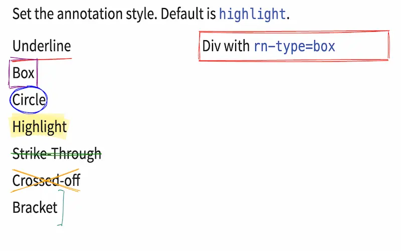{fig-alt="Rough Notation extension" loading="lazy"}](https://github.com/EmilHvitfeldt/quarto-roughnotation)

**[Rough Notation](https://github.com/EmilHvitfeldt/quarto-roughnotation)**
:::

::: {.slidecraft-card}
[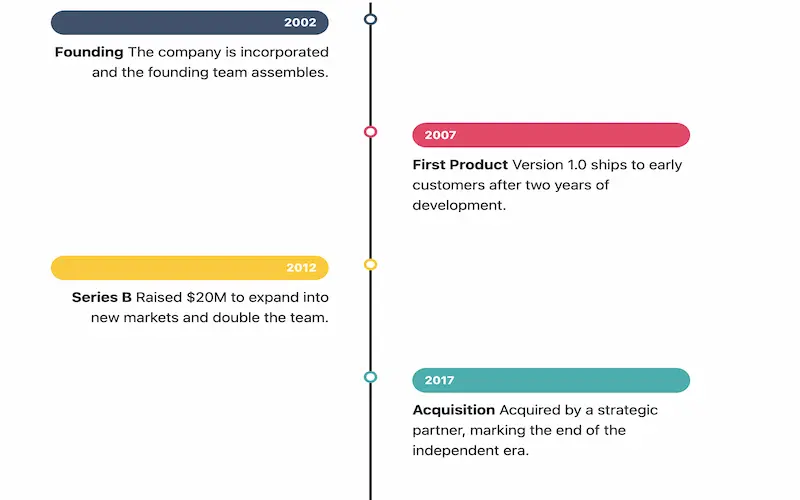{fig-alt="Timeline extension" loading="lazy"}](https://github.com/EmilHvitfeldt/quarto-timeline)

**[Timeline](https://github.com/EmilHvitfeldt/quarto-timeline)**
:::

::: {.slidecraft-card}
[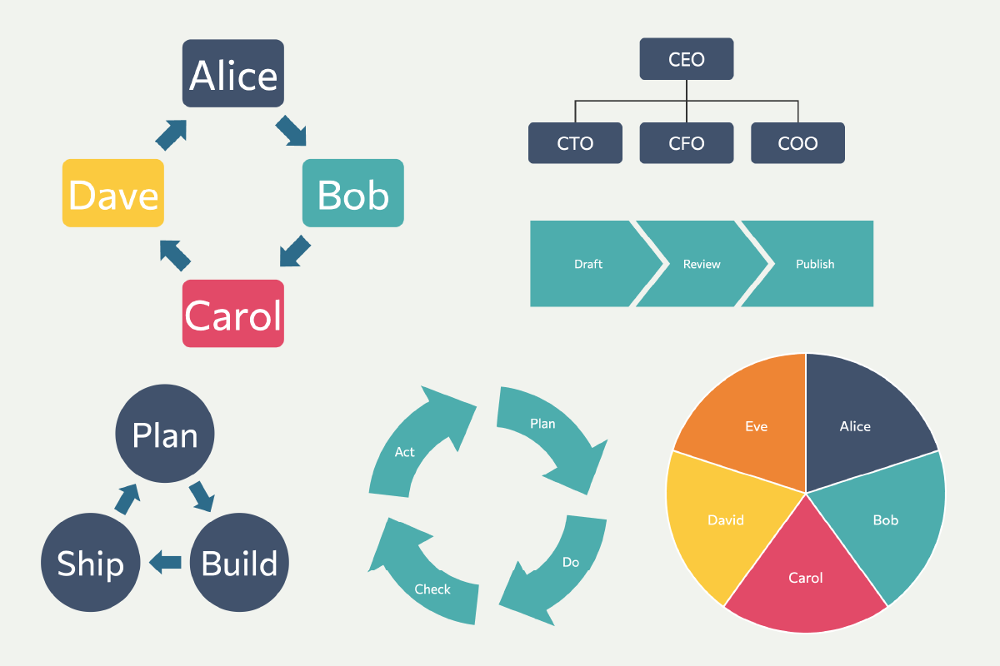{fig-alt="Diagrams extension" loading="lazy"}](https://github.com/EmilHvitfeldt/quarto-diagrams)

**[diagrams](https://github.com/EmilHvitfeldt/quarto-diagrams)**
:::

::: {.slidecraft-card}
[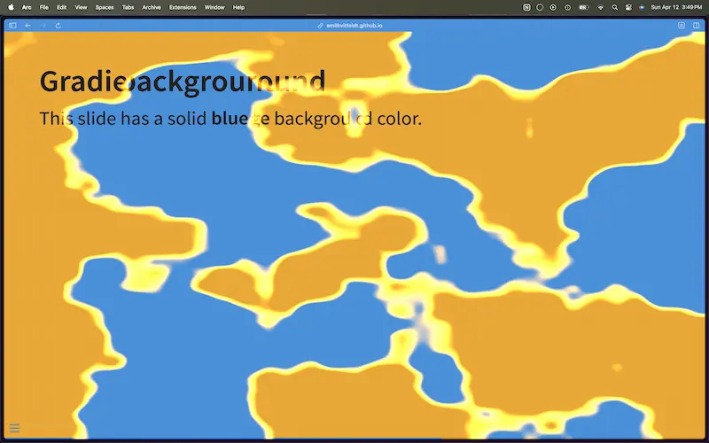{fig-alt="Transitions extension" loading="lazy"}](https://github.com/EmilHvitfeldt/quarto-revealjs-transitions)

**[Transitions](https://github.com/EmilHvitfeldt/quarto-revealjs-transitions)**
:::

::: {.slidecraft-card}
[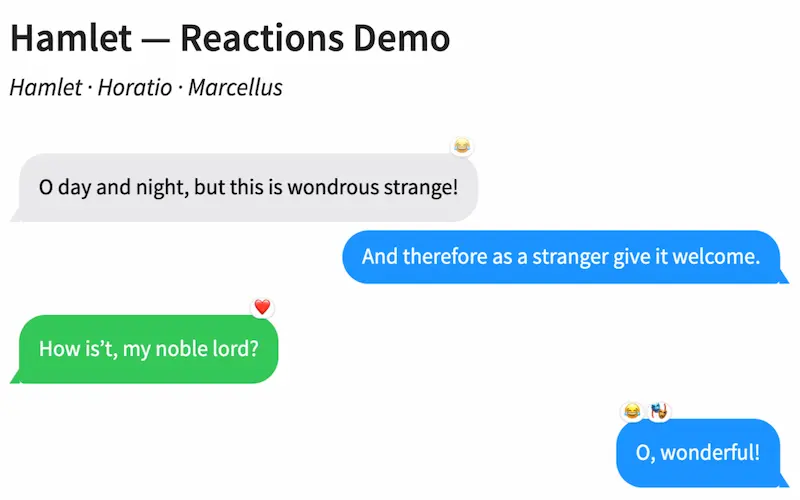{fig-alt="Chat Bubbles extension" loading="lazy"}](https://github.com/EmilHvitfeldt/quarto-revealjs-chat-bubbles)

**[Chat Bubbles](https://github.com/EmilHvitfeldt/quarto-revealjs-chat-bubbles)**
:::

::: {.slidecraft-card}
[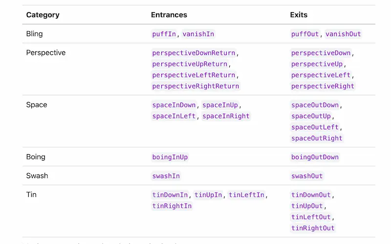{fig-alt="More Fragments extension" loading="lazy"}](https://github.com/EmilHvitfeldt/quarto-revealjs-more-fragments)

**[More Fragments](https://github.com/EmilHvitfeldt/quarto-revealjs-more-fragments)**
:::

::: {.slidecraft-card}
[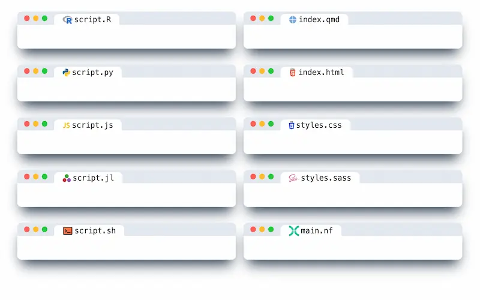{fig-alt="Code Window extension" loading="lazy"}](https://github.com/EmilHvitfeldt/quarto-revealjs-codewindow)

**[Code Window](https://github.com/EmilHvitfeldt/quarto-revealjs-codewindow)**
:::

::: {.slidecraft-card}
[{fig-alt="Tegaki extension" loading="lazy"}](https://github.com/EmilHvitfeldt/quarto-tegaki)

**[Tegaki](https://github.com/EmilHvitfeldt/quarto-tegaki)**
:::

::: {.slidecraft-card}
[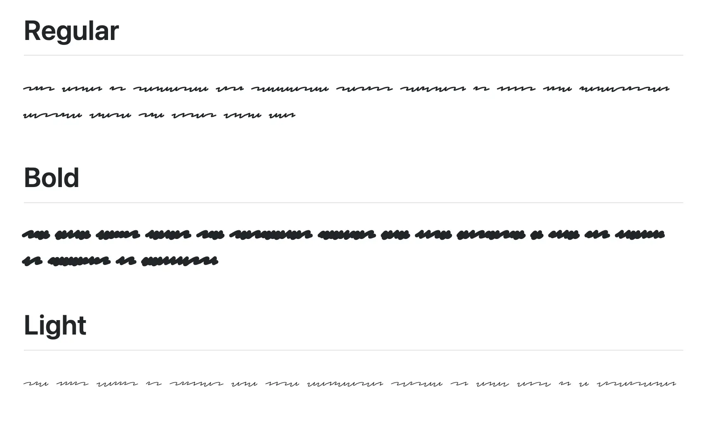{fig-alt="Redacted extension" loading="lazy"}](https://github.com/EmilHvitfeldt/quarto-redacted)

**[Redacted](https://github.com/EmilHvitfeldt/quarto-redacted)**
:::

::: {.slidecraft-card}
[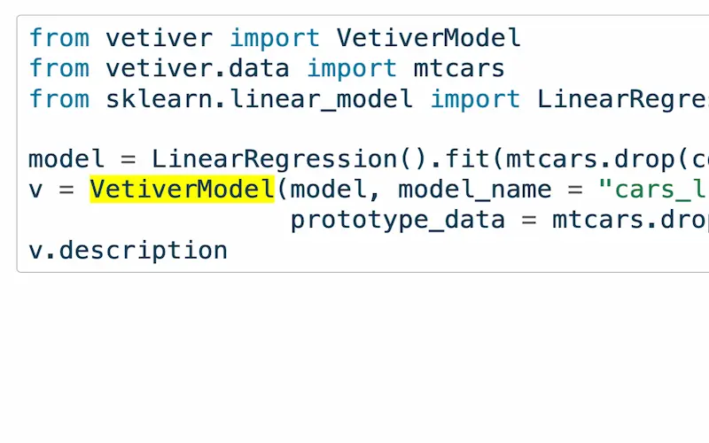{fig-alt="Highlight Word extension" loading="lazy"}](https://github.com/EmilHvitfeldt/quarto-revealjs-highlightword)

**[Highlight Word](https://github.com/EmilHvitfeldt/quarto-revealjs-highlightword)**
:::

::: {.slidecraft-card}
[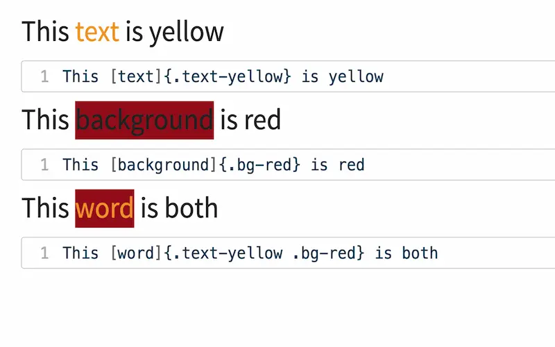{fig-alt="Color Classes extension" loading="lazy"}](https://github.com/EmilHvitfeldt/quarto-color-classes)

**[Color Classes](https://github.com/EmilHvitfeldt/quarto-color-classes)**
:::

::: {.slidecraft-card}
[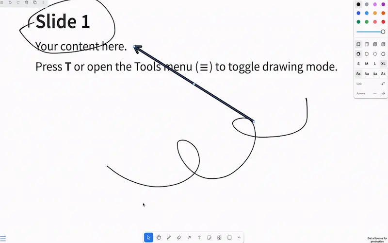{fig-alt="tldraw extension" loading="lazy"}](https://github.com/EmilHvitfeldt/quarto-revealjs-tldraw)

**[tldraw](https://github.com/EmilHvitfeldt/quarto-revealjs-tldraw)**
:::

::: {.slidecraft-card}
[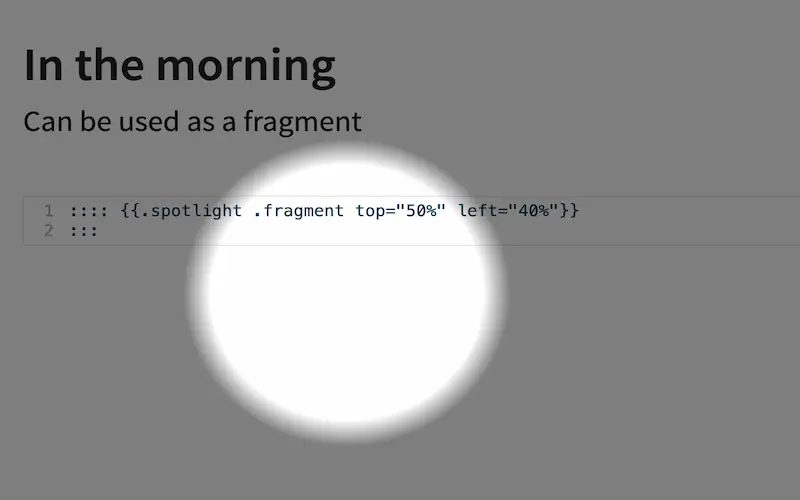{fig-alt="Spotlight extension" loading="lazy"}](https://github.com/EmilHvitfeldt/quarto-revealjs-spotlight)

**[Spotlight](https://github.com/EmilHvitfeldt/quarto-revealjs-spotlight)**
:::

::: {.slidecraft-card}
[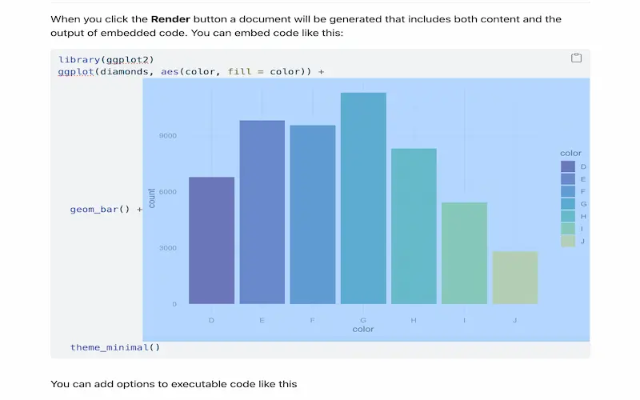{fig-alt="Design Mode extension" loading="lazy"}](https://github.com/EmilHvitfeldt/quarto-designmode)

**[Design Mode](https://github.com/EmilHvitfeldt/quarto-designmode)**
:::

::: {.slidecraft-card}
[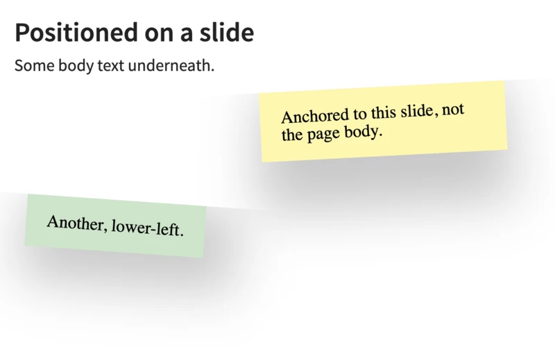{fig-alt="Sticky Notes extension" loading="lazy"}](https://github.com/EmilHvitfeldt/quarto-sticky-notes)

**[Sticky Notes](https://github.com/EmilHvitfeldt/quarto-sticky-notes)**
:::

::: {.slidecraft-card}
[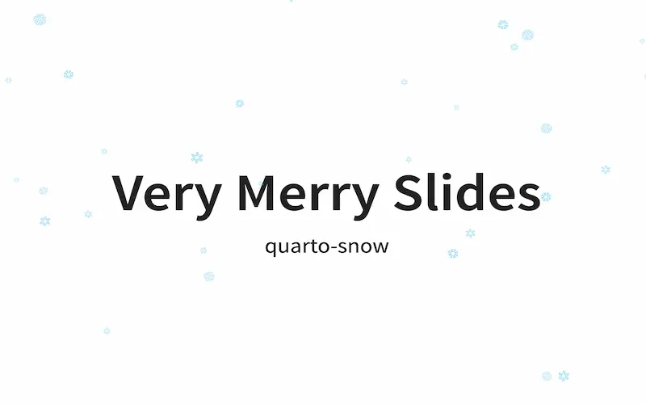{fig-alt="Snow extension" loading="lazy"}](https://github.com/EmilHvitfeldt/quarto-snow)

**[Snow](https://github.com/EmilHvitfeldt/quarto-snow)**
:::

::: {.slidecraft-card}
[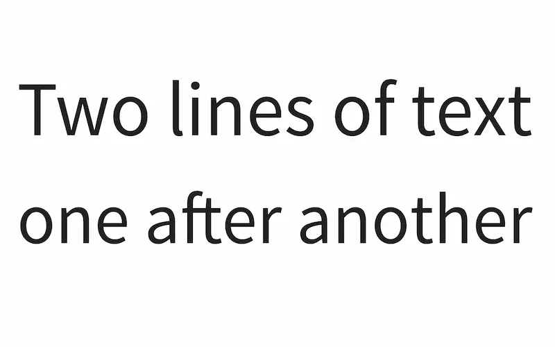{fig-alt="Loud extension" loading="lazy"}](https://github.com/EmilHvitfeldt/quarto-revealjs-loud)

**[Loud](https://github.com/EmilHvitfeldt/quarto-revealjs-loud)**
:::

::: {.slidecraft-card}
[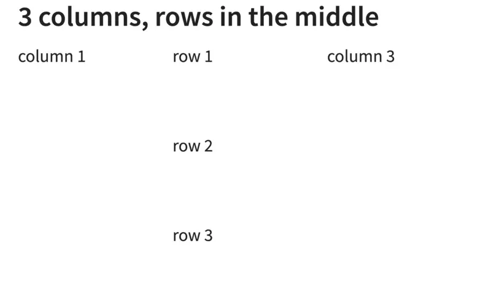{fig-alt="Rows extension" loading="lazy"}](https://github.com/EmilHvitfeldt/quarto-revealjs-rows)

**[Rows](https://github.com/EmilHvitfeldt/quarto-revealjs-rows)**
:::

::: {.slidecraft-card}
[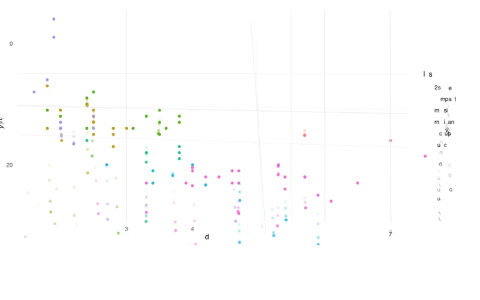{fig-alt="Plot Exit extension" loading="lazy"}](https://github.com/EmilHvitfeldt/quarto-revealjs-plot-exit)

**[Plot Exit](https://github.com/EmilHvitfeldt/quarto-revealjs-plot-exit)**
:::

::: {.slidecraft-card}
[{fig-alt="Video Fragments extension" loading="lazy"}](https://github.com/EmilHvitfeldt/quarto-revealjs-video-fragments)

**[Video Fragments](https://github.com/EmilHvitfeldt/quarto-revealjs-video-fragments)**
:::

::: {.slidecraft-card}
[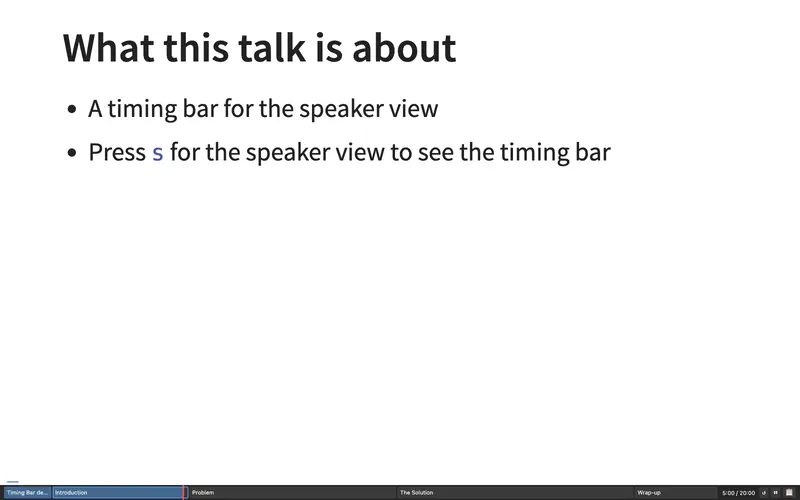{fig-alt="Timing Bar extension" loading="lazy"}](https://github.com/EmilHvitfeldt/quarto-revealjs-timing-bar)

**[Timing Bar](https://github.com/EmilHvitfeldt/quarto-revealjs-timing-bar)**
:::

::: {.slidecraft-card}
[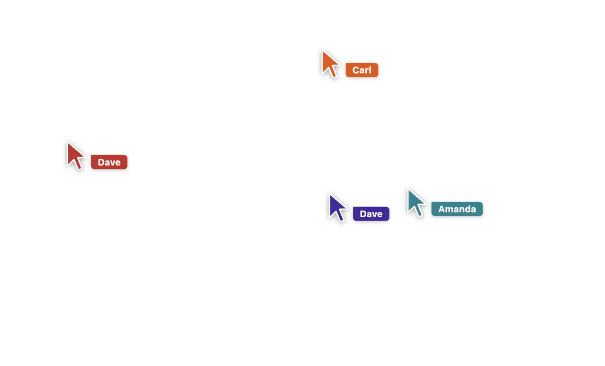{fig-alt="Cursor Fragments extension" loading="lazy"}](https://github.com/EmilHvitfeldt/quarto-revealjs-cursor-fragments)

**[Cursor Fragments](https://github.com/EmilHvitfeldt/quarto-revealjs-cursor-fragments)**
:::

::: {.slidecraft-card}
[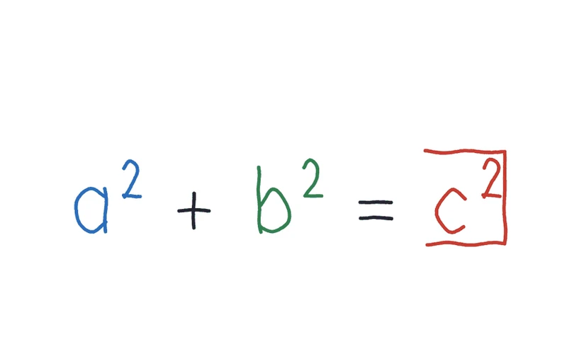{fig-alt="Drawings extension" loading="lazy"}](https://github.com/EmilHvitfeldt/quarto-revealjs-drawings)

**[Drawings](https://github.com/EmilHvitfeldt/quarto-revealjs-drawings)**
:::

:::
